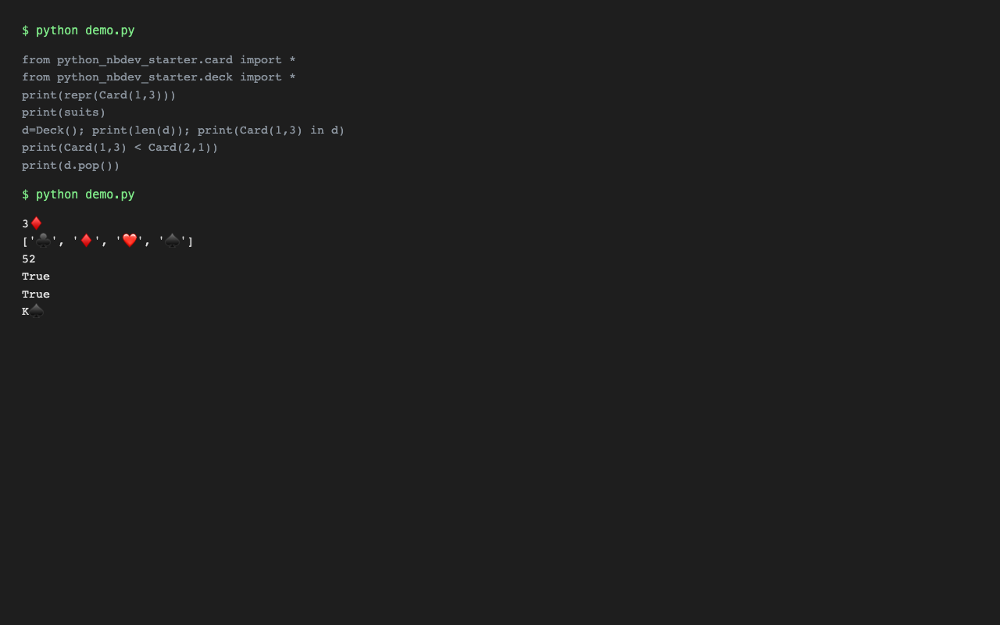

# python_nbdev_starter


<!-- WARNING: THIS FILE WAS AUTOGENERATED! DO NOT EDIT! -->

A deck of cards demo of [nbdev](https://nbdev.fast.ai) based on ideas
from [Think Python 2nd
Edition](https://greenteapress.com/wp/think-python-2e/) by Allen B.
Downey.



*Output of running the `Card`/`Deck` API via a short Python script (code shown in the image).*

## Install

Not published to PyPI. Install from source:

    git clone https://github.com/moneebullah25/python_nbdev_starter
    cd python_nbdev_starter && pip install -e .

## How to use

This lib provides a `Card` class you can use to create, display, and
compare playing cards:

``` python
Card(1,3)
```

    3♦️

Suits are numbered according to this list:

``` python
suits
```

    ['♣️', '♦️', '❤️', '♠️']

## License

Apache License 2.0. See [LICENSE](LICENSE).
